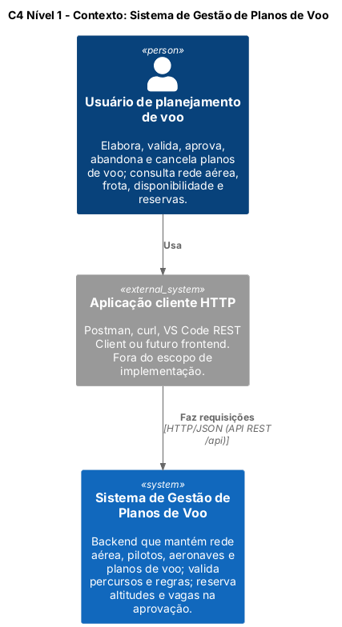
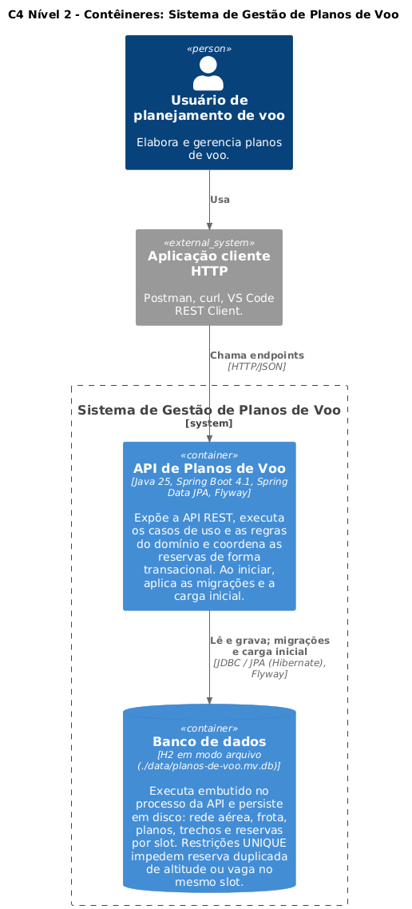
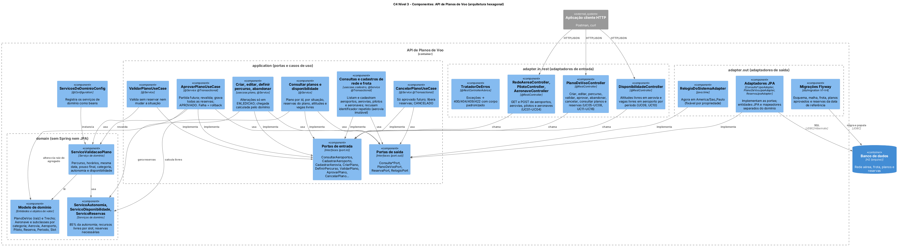
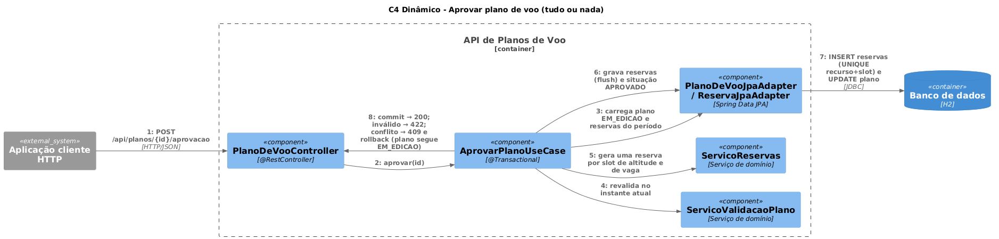

# Arquitetura — Sistema de Gestão de Planos de Voo

Arquitetura **hexagonal (portas e adaptadores)**, organizada como o exemplo `ex7` da disciplina. As decisões e alternativas estão em [`decisoes/decisoes.md`](decisoes/decisoes.md); o modelo de domínio em UML, em [`../dominio`](../dominio).

Os diagramas são PlantUML (biblioteca C4 padrão). Para regenerar: `java -jar plantuml.jar -tpng docs/arquitetura/c4/*.puml`.

## Estrutura de pacotes (`com.bcopstein.voos`)

```
domain                         núcleo, sem Spring nem JPA
  model.aeronave               Aeronave e subclasses por categoria
  model.rede                   Aeroporto, Aerovia
  model.piloto                 Piloto
  model.plano                  PlanoDeVoo (raiz do agregado), Trecho, ResultadoValidacao
  model.reserva                Reserva, TipoReserva
  model.tempo                  Periodo, Slot
  service                      ServicoValidacaoPlano, ServicoAutonomia, ServicoDisponibilidade, ServicoReservas
  exception                    DadosInvalidosException (400), OperacaoNaoPermitidaException (409)
application
  port.in                      interfaces dos casos de uso (+ comandos)
  port.out                     Consulta*Port, PlanoDeVooPort, ReservaPort, RelogioPort
  usecase.cadastro             consultas e cadastros de rede e frota
  usecase.plano                criar, editar, percurso, validar, aprovar, consultar, abandonar, cancelar
  usecase.disponibilidade      altitudes e vagas livres
  exception                    RecursoNaoEncontrado (404), PlanoInvalido (422), ConflitoDeReserva (409)
adapter.in.rest                controllers, DTOs, mappers, TratadorDeErros
adapter.out.persistence        entidades JPA, Spring Data, mappers, adaptadores das portas
adapter.out.tempo              RelogioDoSistemaAdapter
config                         ServicosDeDominioConfig
```

## C4 — Nível 1: Contexto



## C4 — Nível 2: Contêineres



| Contêiner | Tecnologia | Responsabilidade |
|---|---|---|
| API de Planos de Voo | Java 25, Spring Boot 4.1, Spring Data JPA, Flyway | API REST, casos de uso, regras, transações; aplica migrações e carga inicial ao subir |
| Banco de dados | H2 em arquivo (`./data`) | Persistência de rede aérea, frota, planos, trechos e reservas; restrições UNIQUE contra reserva dupla |

## C4 — Nível 3: Componentes



## Diagrama dinâmico — aprovação "tudo ou nada"



A aprovação é uma única transação: revalida, grava uma reserva por recurso e slot e muda a situação. As restrições UNIQUE do banco fazem uma aprovação concorrente falhar; a transação é desfeita, nenhuma reserva parcial fica e o plano continua em edição.

## Como a arquitetura atende à seção 7.2

- **Separação de responsabilidades e regras de negócio:** regras só no `domain`; controllers apenas convertem DTOs; adaptadores JPA apenas convertem dados.
- **Facilidade de verificar o comportamento:** testes de domínio sem Spring (`src/test/java/.../domain`) e teste de integração com H2 em memória.
- **Evolução:** nova categoria = nova subclasse de `Aeronave`; novos aeroportos e aerovias = nova migração Flyway; troca de banco = novo adaptador de saída.
- **Consistência:** aprovação e cancelamento transacionais, reforçados por restrições do banco.
