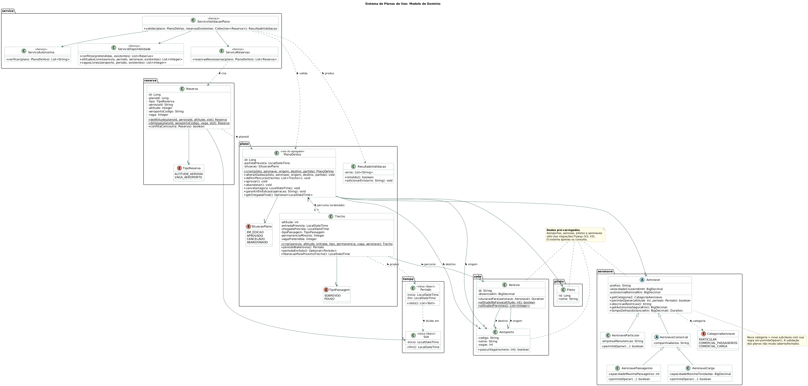

# Modelo de domínio

Fonte PlantUML: [`diagrama-dominio.puml`](diagrama-dominio.puml).

## Principais decisões de modelagem

- **`PlanoDeVoo` é a raiz do agregado** que contém os `Trecho`s. Toda alteração passa por ele (`alterarDados`, `definirPercurso`, `aprovar`, `abandonar`, `cancelar`), e ele recusa mudanças fora de `EM_EDICAO`.
- **`Trecho` calcula a própria chegada** a partir da aerovia e da aeronave: `ceil(distância / velocidade × 3600)` segundos. Assim a chegada nunca vem do cliente.
- **`Aeronave` é abstrata**; cada categoria é uma subclasse com sua regra de operação. A validação usa só `permiteOperar`, sem conhecer as categorias.
- **`Periodo` e `Slot` são objetos de valor** que concentram a regra de slots `[início, fim)` de uma hora alinhados à hora cheia.
- **`Reserva` referencia o plano pelo identificador**, não pelo objeto, para não puxar o agregado do plano ao consultar ocupação.
- **Serviços de domínio** recebem as reservas existentes como parâmetro, sem acessar o banco: o caso de uso as carrega pela porta de saída.
- **Aeroportos, aerovias, pilotos e aeronaves** vêm da carga inicial e são apenas consultados (orientação do professor).
